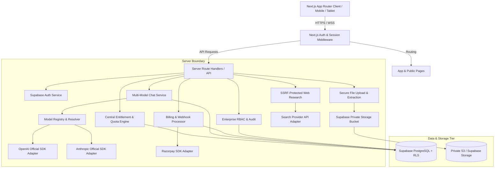

# NEXORA — MASTER IMPLEMENTATION PLAN
**Product:** Nexora — Global Multi-Model AI SaaS Platform  
**Tagline:** One workspace. Many intelligences.  
**Application Version:** `0.1.0-dev` (Initial MVP development)  
**Date:** 2026-10-21  
**Status:** Approved Architecture & Phase 1 Baseline

---

## 1. Executive Summary & Product Vision

Nexora is a multi-model AI Software-as-a-Service (SaaS) platform engineered to unify best-in-class foundation models (OpenAI, Anthropic, and future providers) into a single, cohesive, high-performance workspace. 

### Core Value Proposition
- **Multi-Model Orchestration:** Seamlessly switch between models and branded routing profiles (Nexora Swift, Core, Reason, Vision) with clear capability transparency and provider attribution.
- **Persistent Conversational Memory:** Secure, indexed chat history accessible across all subscription tiers (Free, Pro, Enterprise) with tier-based retention policies.
- **Document-Assisted Reasoning:** Secure, private file uploads with server-side validation, document text extraction (PDF, DOCX, TXT, CSV, MD), and context injection.
- **Source-Grounded Web Research:** Server-side request forgery (SSRF)-protected search integration that retrieves, synthesizes, and directly cites real web sources.
- **Strict Tenant & User Isolation:** Supabase Row Level Security (RLS) enforcing multi-tenant isolation, enterprise role-based access control (RBAC), and zero data leaks.
- **Audited Token Accounting & Quota Reserves:** Concurrency-safe atomic reservations and usage tracking preventing overspending and budget overrun.
- **Modular Billing Integration:** Isolated billing abstraction with Razorpay as candidate provider, featuring strict HMAC-SHA256 signature verification, idempotency tracking, and sandbox/production segregation.

---

## 2. Workspace Inspection Findings

| Item | Finding / Value | Action Required |
| :--- | :--- | :--- |
| **Workspace Path** | `c:\Users\MayimDazzle_10\OneDrive\Documents\Desktop\NEXORA` | Root directory |
| **Existing Files** | None (Clean slate) | Initialize Next.js 14+ App Router project |
| **Node.js Environment** | `v24.18.0` | Compatible with modern Next.js, TypeScript, and modern SDKs |
| **Package Manager** | `npm v11.16.0` | Standard package orchestration |
| **Version Control** | Initialized empty Git repository | Maintain clean commits and changelog |
| **Initial App Version** | `0.1.0` | In accordance with Section 22 guidelines |

---

## 3. Versioning & Identity Framework

To avoid ambiguity, four distinct versioning dimensions are maintained:

1. **Nexora Application Version (`MAJOR.MINOR.PATCH`):**
   - Tracked in `package.json` and centralized in `lib/version.ts`.
   - Starts at `0.1.0-dev` for MVP construction; tagged as `v1.0.0` only upon satisfying all verification and acceptance criteria.
2. **Nexora Branded Model Routing Version:**
   - Managed in the database (`nexora_model_versions` table).
   - Immutable versions (e.g., `nexora-swift@1.0.0`, `nexora-core@1.0.0`, `nexora-reason@1.0.0`, `nexora-vision@1.0.0`).
   - Routing updates require publishing a new immutable version; emergency kill-switches can disable routes with an audited event.
3. **Provider Model Identifiers & Revisions:**
   - Exact provider API model IDs (e.g., `gpt-4o`, `claude-3-5-sonnet-20241022`).
   - Distinguishes fixed snapshot revisions from mutable aliases.
4. **Database Migration Versions:**
   - Sequential, version-controlled SQL files in `supabase/migrations/` (e.g., `20261021000001_initial_schema.sql`).

---

## 4. System Architecture



---

## 5. Technology Stack & Dependencies

| Layer | Selection | Justification |
| :--- | :--- | :--- |
| **Framework** | Next.js 14+ (App Router) | Server components, streaming responses, API routes, edge middleware |
| **Language** | TypeScript (Strict Mode) | Type-safe contracts across API boundaries and database entities |
| **Styling** | Vanilla Tailwind CSS + Custom Design Tokens | Fast, responsive, accessible, zero-runtime overhead, dark/light theme |
| **UI Components** | Radix UI primitives & Lucide Icons | Accessible, keyboard-navigable, unstyled foundational components |
| **Validation** | Zod | Runtime schema validation for API inputs, environment variables, webhooks |
| **Database & Auth** | Supabase (PostgreSQL, GoTrue Auth, Storage) | Native RLS, JWT verification, private storage, migrations |
| **AI SDKs** | Official `openai` & `@anthropic-ai/sdk` | High-fidelity streaming, token reporting, error taxonomy |
| **Payments** | Official `razorpay` Node SDK | Standard SaaS recurring/order APIs with webhook signature verification |
| **Testing** | Vitest, React Testing Library, Playwright | Unit, integration, and end-to-end browser verification |

---

## 6. Database Schema & Data Models

All tables are created via committed PostgreSQL migrations with Row Level Security (RLS) enabled.

### 6.1 Identity & Organizations
- `profiles`: `id` (references `auth.users`), `email`, `full_name`, `avatar_url`, `created_at`, `updated_at`.
- `user_preferences`: `user_id`, `theme`, `default_model_id`, `system_prompt_preference`, `stream_response`.
- `organisations`: `id`, `name`, `slug`, `created_by`, `plan_id`, `created_at`, `updated_at`.
- `organisation_members`: `id`, `org_id`, `user_id`, `role` (`owner`, `admin`, `member`), `joined_at`.
- `organisation_invitations`: `id`, `org_id`, `email`, `role`, `token_hash`, `expires_at`, `created_at`.
- `organisation_policies`: `id`, `org_id`, `allowed_models` (JSONB/array), `max_monthly_spend_cents`, `retention_days`.

### 6.2 AI Registry & Routing
- `providers`: `id`, `key` (e.g. `openai`, `anthropic`), `display_name`, `status` (`active`, `disabled`, `maintenance`), `docs_url`.
- `models`: `id`, `provider_id`, `provider_model_id`, `display_name`, `description`, `identifier_kind`, `input_modalities`, `output_modalities`, `capabilities` (JSONB), `context_window`, `max_output_tokens`, `input_price_per_million`, `output_price_per_million`, `status`, `verified_at`.
- `nexora_model_families`: `id`, `slug` (`nexora-swift`, `nexora-core`, `nexora-reason`, `nexora-vision`), `display_name`, `description`, `status`.
- `nexora_model_versions`: `id`, `family_id`, `version_major`, `version_minor`, `version_patch`, `version_label`, `status`, `release_notes`, `capability_snapshot`, `published_at`, `published_by`.
- `nexora_model_routes`: `id`, `model_version_id`, `external_model_id`, `priority`, `route_role` (`primary`, `fallback`), `enabled`.
- `model_plan_access`: `id`, `plan_id`, `model_id` (or family/version reference), `enabled`.
- `model_registry_audit_events`: `id`, `actor_id`, `action`, `target_type`, `target_id`, `metadata`, `created_at`.

### 6.3 Chat & Conversations
- `conversations`: `id`, `user_id`, `org_id` (nullable), `title`, `model_selected`, `pinned`, `archived`, `created_at`, `updated_at`.
- `messages`: `id`, `conversation_id`, `role` (`user`, `assistant`, `system`), `content`, `model_used`, `tokens_in`, `tokens_out`, `cost_estimate_cents`, `created_at`.
- `message_attachments`: `id`, `message_id`, `file_id`, `created_at`.

### 6.4 Files & Web Research
- `files`: `id`, `user_id`, `org_id` (nullable), `storage_path`, `file_name`, `file_size_bytes`, `mime_type`, `extracted_text`, `status` (`uploaded`, `processing`, `ready`, `failed`), `created_at`.
- `research_sessions`: `id`, `user_id`, `conversation_id`, `query`, `status`, `created_at`.
- `research_sources`: `id`, `session_id`, `title`, `url`, `snippet`, `citation_index`, `created_at`.

### 6.5 Billing & Entitlements
- `plans`: `id` (`free`, `pro`, `enterprise`), `display_name`, `description`, `price_cents_monthly`, `currency`, `daily_message_limit`, `monthly_message_limit`, `monthly_research_limit`, `max_file_size_mb`, `storage_limit_mb`, `retention_days`, `is_active`.
- `subscriptions`: `id`, `user_id`, `org_id` (nullable), `plan_id`, `status` (`active`, `canceled`, `past_due`, `incomplete`), `provider` (`razorpay`), `external_subscription_id`, `current_period_start`, `current_period_end`, `cancel_at_period_end`.
- `quota_reservations`: `id`, `user_id`, `quota_type` (`message`, `research`), `amount`, `status` (`reserved`, `reconciled`, `released`), `expires_at`, `created_at`.
- `usage_events`: `id`, `user_id`, `org_id` (nullable), `model_id`, `tokens_in`, `tokens_out`, `estimated_cost_cents`, `operation_type`, `created_at`.
- `webhook_events`: `id`, `provider`, `event_id`, `event_type`, `payload`, `processed_at`.

---

## 7. Entitlement & Quota Reservation Engine

The entitlement engine prevents race conditions and overspending through a four-step transactional lifecycle:
1. **Pre-Flight Validation:** Inspects active plan, organization policy, and current period usage.
2. **Atomic Reservation:** Inserts a temporary row in `quota_reservations` with a 2-minute TTL.
3. **Execution:** Streams the AI generation or performs web search.
4. **Reconciliation:** On success, inserts an immutable `usage_events` record and marks reservation `reconciled`. On timeout or error, reservation is marked `released`.

### Configurable Plan Defaults
| Feature | Free Tier | Pro Tier | Enterprise Tier |
| :--- | :--- | :--- | :--- |
| **Daily AI Messages** | 10 messages / day | 100 messages / day | Configurable |
| **Monthly AI Messages** | 100 messages / month | 2,000 messages / month | Configurable |
| **Web Research** | 3 searches / month | 100 searches / month | Configurable |
| **Chat History** | Included (30-day retention) | Included (1-year retention) | Included (Custom policy) |
| **File Uploads** | Included (5 MB / file, 50 MB total) | Included (25 MB / file, 1 GB total) | Included (100 MB / file, Custom total) |
| **Eligible Models** | Basic models (Nexora Swift, Core) | Expanded (Reason, Vision, OpenAI, Anthropic) | All verified models + admin policies |
| **Collaboration** | 1 Personal workspace | 1 Personal workspace | Multi-seat orgs with RBAC & Audit |

---

## 8. Multi-Model AI Routing Architecture

```typescript
// Core abstraction interfaces
export interface AIProvider {
  id: string;
  name: string;
  streamCompletion(request: ChatCompletionRequest): AsyncIterable<ChatChunk>;
  generateCompletion(request: ChatCompletionRequest): Promise<ChatCompletionResponse>;
  checkHealth(): Promise<boolean>;
}

export interface ModelRoutingService {
  resolveModel(selectionId: string, planId: string): Promise<ResolvedRoute>;
  executeWithFallback(request: ChatCompletionRequest, routes: ResolvedRoute[]): AsyncIterable<ChatChunk>;
}
```

- **Fail-Safe Fallback:** If the primary provider model throws a transient error (503 / 429), the resolver cleanly routes to the configured fallback route within the same capability and plan boundaries.
- **Attribution & Transparency:** Both the Nexora branded profile and the underlying provider model ID are logged in usage events and displayed to the user.

---

## 9. Security & Compliance Controls

1. **Server-Side Secret Isolation:** No provider API keys or service role keys ever enter client bundles.
2. **SSRF Protection:** Web research validation checks target URLs against denylists (`127.0.0.1`, `10.0.0.0/8`, `169.254.0.0/16`, `localhost`, AWS/cloud metadata services).
3. **MIME & Content Validation:** File uploads verify true magic bytes, not merely client-supplied extensions.
4. **Row Level Security (RLS):** Every table has strict RLS preventing cross-tenant or cross-user data visibility.
5. **Webhook Cryptography:** Razorpay webhooks require raw-body HMAC-SHA256 signature verification and replay prevention via `webhook_events` deduplication.

---

## 10. Implementation Phases & Milestones

- **Phase 1: Planning & Baseline Documentation** *(Current Phase)*
  - Establish `docs/IMPLEMENTATION_PLAN.md` and repository foundation.
- **Phase 2: Project Foundation, Design System & Public Pages**
  - Next.js 14+ App Router setup, dark/light theme tokens, landing page, pricing, features, models directory, security, legal pages, application shell.
- **Phase 3: Authentication & Database Migrations**
  - Supabase client/server setup, initial migrations, RLS policies, profiles, conversations persistence.
- **Phase 4: Central Entitlement & Quota Engine**
  - Quota engine, atomic reservation, period calculation, plan definitions.
- **Phase 5: Multi-Model AI Chat & Registry**
  - Model registry, OpenAI and Anthropic adapters, streaming chat UI, markdown/syntax highlighting, retry/cancellation.
- **Phase 6: File Uploads & Web Research**
  - Private Supabase storage, file parsing pipeline, SSRF-guarded web research with citations.
- **Phase 7: Usage, Analytics & Cost Accounting**
  - Token tracking, usage dashboards, budget limits, cost estimates.
- **Phase 8: Billing & Subscription Management**
  - Razorpay adapter, subscription flows, idempotent webhook processing.
- **Phase 9: Enterprise Workspaces & Governance**
  - Organizations, invitations, member roles, model approval policies, audit logging.
- **Phase 10: Quality Assurance, Security Audit & Verification**
  - Unit tests, integration tests, Playwright E2E suite, security validation, type checking, linting.
- **Phase 11: Deployment Preparation & Release Documentation**
  - Production environment configuration, runbooks, changelog, launch checklist.

---

## 11. Acceptance Criteria Mapping

| Category | Requirement | Verification Method |
| :--- | :--- | :--- |
| **Application** | Responsive UI, working routes, loading/empty/error states | Playwright E2E + Vitest component tests |
| **Security** | RLS enforcement, zero secret exposure, SSRF prevention | Automated security test suite & policy tests |
| **AI Integration**| OpenAI & Anthropic adapters, streaming, fallback, attribution | Provider integration tests with mock fixtures |
| **Core SaaS** | Chat history, file uploads, web research enabled on all plans | Entitlement engine unit tests |
| **Billing** | Webhook verification, idempotency, lifecycle management | Webhook signature test suite |
| **Enterprise** | Multi-seat orgs, RBAC, approved models, audit log | Multi-tenant isolation test suite |
